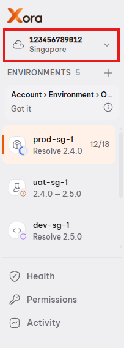
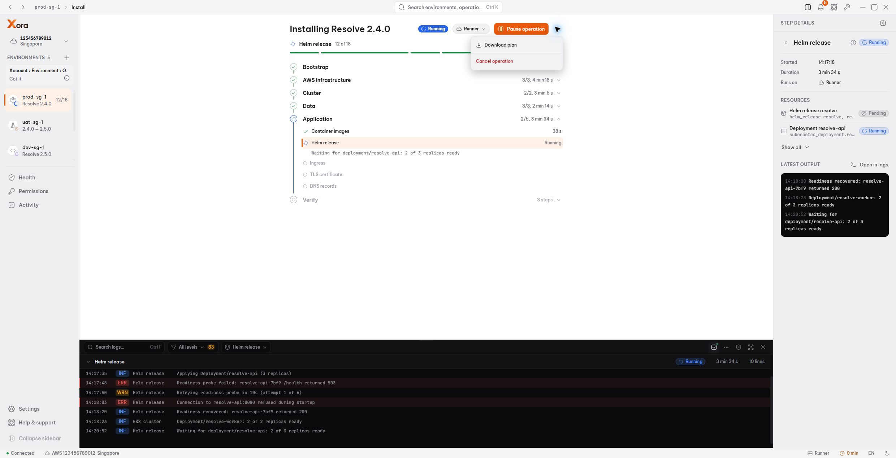
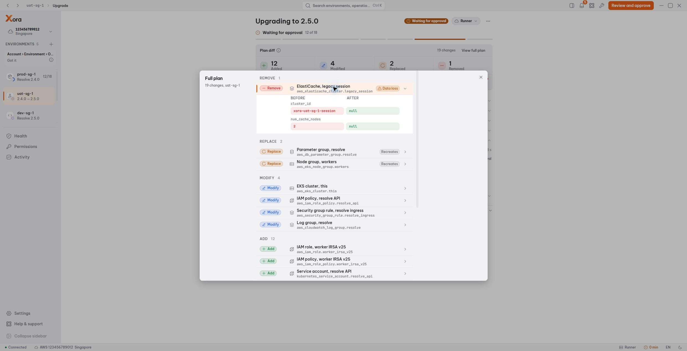
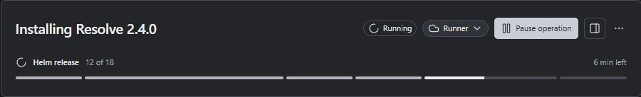
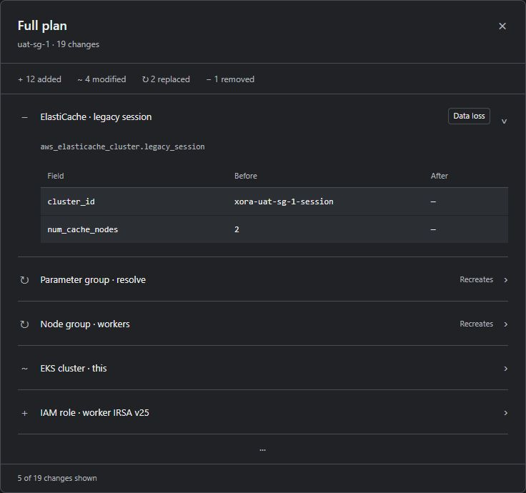

# Góp ý Xora

1. **Font:** chuyển UI sang Inter, giữ monospace cho ID và logs. Chữ chính khoảng 13–14 px, metadata 12 px; giảm việc dùng weight 500 cho mọi nội dung.

2. **Icon collapse sidebar:** sửa hướng icon. Sidebar đang mở dùng `panel-left-close`; thu gọn dùng `panel-left-open`.

3. **Full plan:** sửa modal thành một cột danh sách, mở diff ngay dưới resource. Header nằm ngang, gồm tên modal, environment và số thay đổi. Gộp Added/Modified/Replaced/Removed thành một hàng ngắn. Khi mở resource mới hiện ID và bảng `Field | Before | After`. Bỏ cột tiêu đề riêng và khoảng trống thừa bên phải; giữ header khi cuộn danh sách.

4. **Navigation:** đưa Health, Permissions, Activity lên trên ENVIRONMENTS. Cho danh sách environment dùng chiều cao còn lại và cuộn độc lập. Giữ Settings, Help và Collapse ở đáy.

5. **Toggle details:** chuyển khỏi window bar xuống góc phải header của cell, sau **Pause operation** và trước menu `…`. Dùng nút icon panel, tooltip “Show details” / “Hide details” và trạng thái active khi panel mở. Giữ phím tắt Ctrl+I.

6. **Status trên environment card:** tách nền status khỏi nền sidebar bằng nền riêng hoặc viền ngăn mảnh. Giữ cách gắn status vào icon; kiểm tra cả card được chọn và chưa được chọn.

7. **Show logs:** thêm vào submenu hiện có, trước Download plan. Mở console sẵn có; nếu console đã mở thì đưa focus vào đó. Giữ cách xem log theo từng step.

   ```text
   Show logs
   Download plan
   ─────────────
   Cancel operation
   ```

8. **Console logs:** giảm độ tối trong light theme, dùng nền xám trung tính cùng hệ surface của app. Giữ chữ log thường trung tính, chỉ nhấn WARN/ERROR. Không đổi bố cục console.

9. **Account switcher:** giữ account ID/region để nhận biết context, bỏ dropdown đổi account ngay trong luồng operation. Đưa việc chọn account về Settings hoặc màn chọn account. Chuyển account để xem môi trường khác không làm đổi account/runner của operation đang chạy.

## Sidebar hiện tại



## Menu và console hiện tại



## Full plan hiện tại



## Wireframe header cell



## Wireframe Full plan


