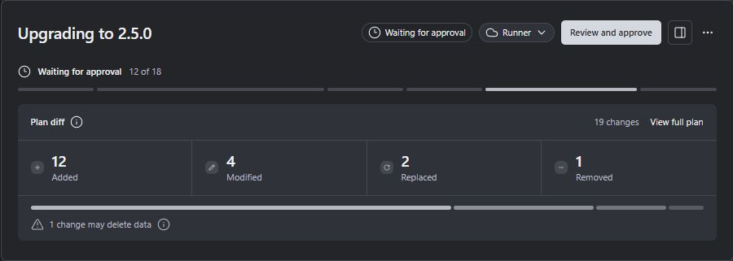
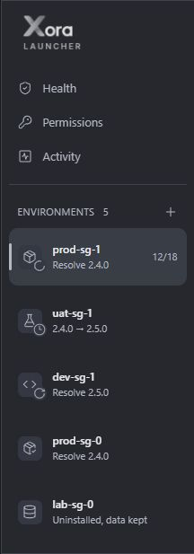

# Góp ý Xora

1. **Review and approve:** chuyển khỏi window bar xuống góc phải header cell, sau **Runner** và trước **Details**, cùng nhóm với menu `…`. Chỉ hiển thị khi operation chờ duyệt; giữ nguyên luồng review hiện tại. Khi header thiếu chiều rộng, cho nhóm thao tác xuống hàng trong nội dung cell.

2. **Logo:** thêm subname **LAUNCHER** dưới Xora theo mẫu; dùng chữ in hoa nhỏ, giãn ký tự và màu phụ. Giữ nguyên logo Xora.

3. **Account trên nav:** bỏ hẳn khối account ID/region dưới logo vì không còn chọn account. Thông tin này đã có ở thanh trạng thái phía dưới. Đưa Health, Permissions, Activity lên ngay dưới logo, để ENVIRONMENTS có thêm không gian.

## Wireframe Review and approve

## Logo tham chiếu

## Wireframe sidebar

